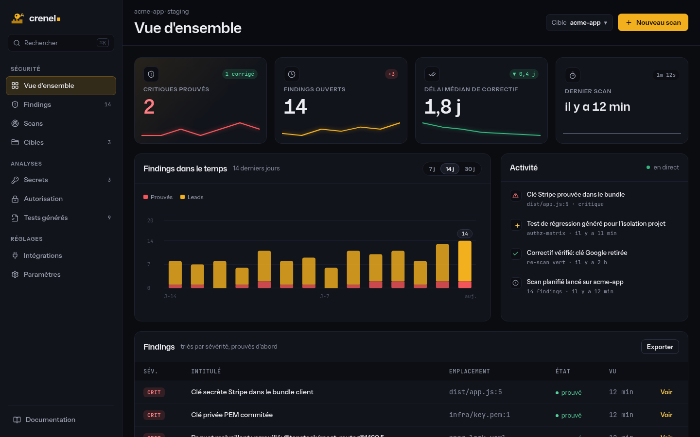
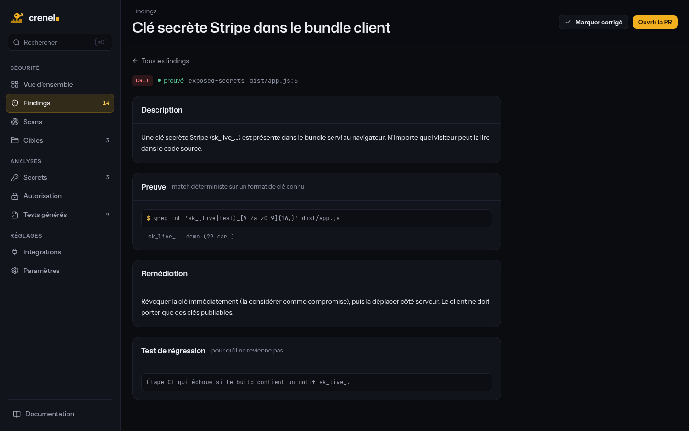
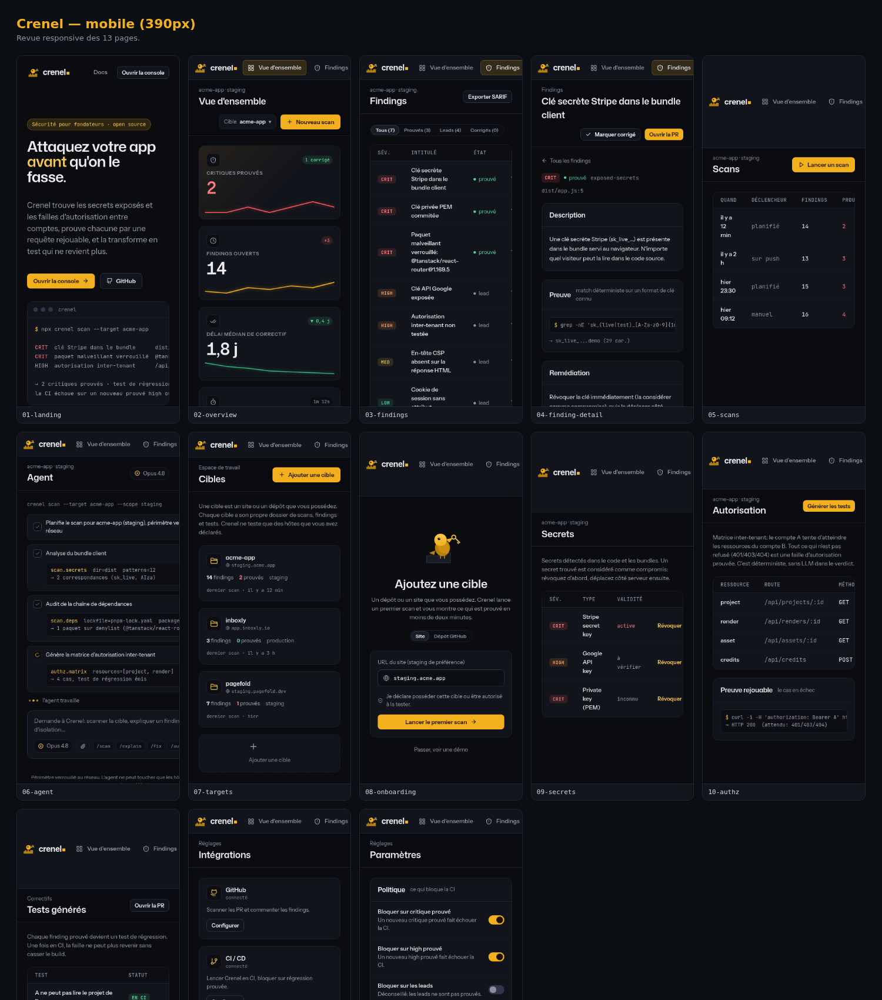

# Bastion

> Product/UI working name: **Crenel** (Bastion is taken). Brand, mascot and web
> console live under that name; see `docs/IDENTITY.md`. The engine package is
> still `bastion` pending the final name.

A defensive security harness for SaaS. It helps you attack your own app before anyone else does, then turns each finding into something that stays fixed.

Bastion exists because new SaaS, and especially apps built fast with AI, keep shipping the same few bugs: a secret in the client bundle, and one account able to read another account's data. Bastion checks for exactly those, proves them so you do not chase false alarms, and hands you a regression test so they cannot come back.

> Status: early but real. The core, the scope guard and eleven checks (secrets,
> dependency-risk, ci-hardening, headers, authz-matrix, cloudflare-audit,
> mcp-surface, dockerfile, committed-env, sourcemaps, public-env) run today, with
> 73 tests. More depth is planned (see the roadmap).

## The console



Every finding opens to its proof and a one-click regression test. The console is
read-only over the engine's output; it renders the same model the CLI produces.

<table>
<tr>
<td></td>
<td></td>
</tr>
</table>

Every check, what it flags and how to fix it: [`docs/CHECKS.md`](docs/CHECKS.md).

## What makes it different

Three ideas from the research on AI security agents are baked into the design:

1. **Proof over noise.** Agent and scanner findings are mostly false positives when they are not validated. Every Bastion finding is either `proven` (a deterministic match or a replayable request) or clearly marked `unproven` and treated as a lead, never a gate.
2. **Deterministic where it counts.** LLMs are near-blind to authorization bugs spread across files. So the authorization check is not an LLM: it is a declarative matrix you can read, run, and keep in CI.
3. **Scope lives in code, not in a prompt.** Bastion only touches hosts you declare you own. Active testing is off by default, and destructive actions are never allowed. Pointed at a stranger's site, it does nothing but read what a normal visitor already sees.

## Install and try it

```bash
pnpm install
pnpm demo          # scans the bundled vulnerable example, offline
```

You should see proven `critical` findings (a Stripe secret key and a known-malicious
package shipped in the example), plus `leads` from the authorization matrix and CI
checks. The command exits non-zero on purpose: a proven high/critical finding is a
CI gate, not a crash.

## Use it on your project

```bash
pnpm bastion init                       # writes bastion.config.yaml
# edit the config: point projectDir at your built bundle, list hosts you own
pnpm bastion scan --config bastion.config.yaml
pnpm bastion scan --json --out bastion-report.json   # for CI
```

`bastion scan` exits non-zero only when a **proven high or critical** finding exists, so it is safe to gate a pipeline on it without flaky failures from leads.

### Baseline and regressions

Record what you have today, then let later scans show only what changed:

```bash
pnpm bastion scan --config bastion.config.yaml --update-baseline --baseline bastion-baseline.json
# later, in CI:
pnpm bastion scan --config bastion.config.yaml --baseline bastion-baseline.json
```

The diff reports what is **new** (a regression), what you **fixed** (a finding that was proven before and is gone now), and what **persists**. The scan exits non-zero if a new proven high or critical appears, so a regression breaks the build while known, accepted leads do not.

## The two checks today

| Check | Kind | What it catches |
|---|---|---|
| `exposed-secrets` | read-only, offline | Server-side keys and private keys shipped into a client bundle (Stripe, AWS, Google, OpenAI, Anthropic, GitHub, Supabase service role, PEM blocks). |
| `dependency-risk` | read-only, offline | Supply-chain risk in your dependencies: a locked package whose exact version is on a malware denylist (proven), plus install hooks, non-registry deps and a missing lockfile (leads). |
| `ci-hardening` | read-only, offline | Risky GitHub Actions workflows: `pull_request_target`, actions not pinned to a commit SHA, and installs without `--ignore-scripts`. |
| `headers` | read-only | Missing security headers (CSP, HSTS, nosniff, frame-options, referrer) and cookie flags on your staging response. |
| `authz-matrix` | read-only to generate, active to probe | One account reaching another account's objects. Generates a CI test always; with a staging URL and test accounts (opt-in), it replays each cross-tenant request and proves any that are not denied. |

Run `bastion list` to see them.

## Configuration

```yaml
project: my-saas
projectDir: ./dist           # directory scanned for secrets
scope:
  allowedHosts: [staging.example.com]
  allowActiveTesting: false  # must be true for live authz probes
  stagingUrl: https://staging.example.com
checks: []                   # empty = all read-only checks
options:
  authz-matrix:
    resources:
      - { name: project, path: /api/projects/:id, methods: [GET] }
    accounts:
      a: { token: "<staging token for account A>" }
      b: { owns: { project: ["<id owned by B>"] } }
```

## Safety and scope

Bastion is built to be safe to publish and safe to run. The scope guard (`src/core/scope.ts`) refuses any request to a host not in `allowedHosts`, refuses active checks unless you opt in, and never performs destructive actions. Every outbound request goes through a scoped HTTP client (`src/core/net.ts`) that also refuses hosts resolving to private or loopback addresses (set `scope.allowPrivate` only for an internal staging box you own), re-validates every redirect hop against the allowlist, and caps the response body. Only ever point it at systems you own or are explicitly authorised to test. It is a hardening tool, not an attack tool.

## Web console

A React + Vite app lives in `web/` (the Crenel console): overview, agent run
(a Claude-Code-style prompt and streamed steps), findings and detail, targets,
secrets, authorization matrix, generated tests, integrations, settings, and a
landing page. Run it with `cd web && pnpm install && pnpm dev`.

## Commands

- `scan` — run checks; `--out` JSON, `--sarif` SARIF 2.1.0, `--audit` JSONL log, `--baseline`/`--update-baseline` for regressions.
- `generate-tests` — emit one regression test per finding (`--out`), so a fixed issue cannot return.
- `triage` — experimental LLM triage of leads via the local Claude CLI (advice only, never proves).
- `list`, `init`.

## Roadmap

Needs the user's credentials or a product decision (not done autonomously):
- Auto-PR of the generated tests and fixes to GitHub.
- Hosted/continuous scanning and a trust page.
- Run cloudflare/security-audit-skill end to end (the `cloudflare-audit` check
  already ingests and normalises its `findings.json`; wiring the skill run is
  the remaining, network-touching part).

Self-contained next steps, in priority order from the Nov 2026 research
(see `docs/NIGHT-SUMMARY.md`):
- Deepen `authz-matrix`: beyond status codes, compare the two tenants' response
  bodies so a `200` that returns another account's data is itself proof. This is
  the differentiation the market leaves open.
- `dependency-risk`: add a version age / publisher signal (flag freshly published
  or unusual-publisher versions) to blunt slopsquatting and maintainer takeovers.
- Secrets: do not compete on detection; add liveness verification and a rotation
  path, or consume an existing detector's output.
- Give findings a repo-relative path so generated tests resolve from the repo
  root (today their paths are relative to the scanned projectDir).
- Pin the vetted IP into the connection for live checks, to close the residual
  DNS-rebinding window (the scoped client re-checks on redirects but `fetch`
  re-resolves after the pre-flight `lookup`). Threat needs an attacker who
  controls DNS for a host you declared you own.
- Let the baseline gate only *new* proven high/criticals (today a proven
  high/critical fails CI whether or not it is in the baseline).
- A Tauri desktop app over the same core.

Done since the first draft: the `mcp-surface` check (flags committed agent/MCP
config, a 2026 attack surface) and the `dockerfile` check (container hardening:
root user, unpinned base, baked secrets, ADD-from-URL, curl|sh) and the
`committed-env` check (flags a committed .env, which holds secrets no key-shape
scanner would catch); malware denylist synced from OSV in CI
(`pnpm sync-denylist`, run weekly by `security.yml`); SARIF 2.1.0 output;
JSONL audit log; regression-test generation.

## License

MIT. See [LICENSE](./LICENSE).
