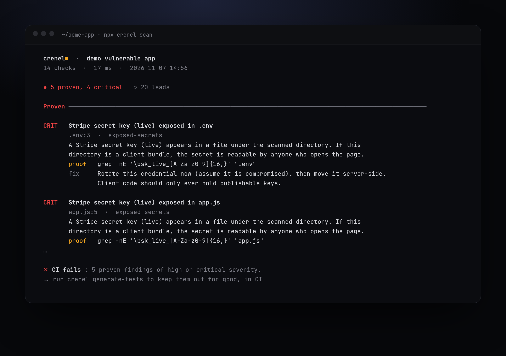

<div align="center">


# Crenel

**Attack your own app before anyone else does.**

Crenel finds exposed secrets and cross-account authorization bugs in your SaaS,<br>
proves each one with a replayable request, and turns it into a regression test.

[](LICENSE)
[](package.json)
[](tsconfig.json)
[](docs/CHECKS.md)
[](#contributing)
[](#quick-start)

Free · local · no account · no LLM required



</div>

## Why

Apps shipped fast, often with AI, keep making the same mistakes: a server key in the client bundle, a Supabase table without RLS, one account able to read another's data. Scanners report hundreds of maybes. Crenel reports what it can **prove**.

- **Proof, not noise.** A finding is `proven` only when a deterministic validator replays it. Everything else is a `lead`. Only proven findings fail your build.
- **Authorization done right.** Two test accounts, a declarative matrix, and a response-body oracle with a negative control. A `200` alone is never a leak.
- **Fixed stays fixed.** Every proven flaw becomes a test in your CI.
- **Scope in code, not in a prompt.** Crenel only reaches hosts you declare. Active probes are opt-in and nothing destructive is ever sent.

## Quick start

> Not on npm yet. Run it from a clone.

```bash
pnpm install && pnpm build
pnpm demo                      # offline scan of the bundled vulnerable app
```

On your project:

```bash
pnpm crenel init               # writes crenel.config.yaml
pnpm crenel scan               # point projectDir at your build, list the hosts you own
pnpm crenel generate-tests     # one regression test per finding
```

## What it catches

| | Checks |
| --- | --- |
| **Secrets** | `exposed-secrets` server keys in the bundle (Stripe, AWS, OpenAI, Anthropic, Supabase `service_role`…) · `live-bundle` the same on every JS chunk your live site serves · `git-history` keys deleted from the code but not from the history · `public-env` · `committed-env` · `committed-credentials` · `sourcemaps` |
| **Authorization** | `authz-matrix` account A reaching account B's objects, anonymous access, proven live on staging |
| **BaaS & storage** | `baas-exposure` Supabase or Firebase tables readable with the public key (missing RLS) · `storage-buckets` S3, R2, GCS buckets anyone can list |
| **Supply chain** | `dependency-risk` known-malware versions, install hooks · `ci-hardening` · `dockerfile` · `mcp-surface` |
| **Server code** | `webhook-signature` unverified Stripe, GitHub or Clerk webhooks · `ssrf` fetching a URL from the request |
| **Deployed site** | `exposed-files` .env, .git, dumps and debug pages your host serves by mistake · `graphql` introspection open to anyone · `open-redirect` login links that bounce anywhere · `next-middleware` CVE-2025-29927 auth bypass · `subdomain-takeover` · `transport` HTTPS and certificate expiry · `dev-server` · `vercel-preview` · `cache-deception` private pages served from the CDN cache |
| **AI stack** | `ai-infra` Ollama, model APIs, Qdrant, Chroma, Weaviate, Flowise, Langflow open without auth |
| **Mail** | `email-dns` SPF and DMARC, so nobody sends password resets as you |
| **Config** | `headers` · `jwt-config` · `tls-verification` · `cloudflare-audit` |

Details and fixes: [`docs/CHECKS.md`](docs/CHECKS.md).

**Let a model read your chunks too.** `crenel review-bundle` hands every JS chunk the live site serves to `claude -p` and lists what no pattern catches: internal endpoints, browser-only role checks, hidden routes, debug code. Each item quotes the served file verbatim or is dropped, and stays a lead until a deterministic check replays it.

## Web console

```bash
node dist/cli.js serve --config crenel.config.yaml --open
```

A local agent console on `127.0.0.1`: start a task, follow each tool step by step, approve probes (or run in *Bypass*, still inside the perimeter), and set a **goal** the agent works toward until it is proven. See [`docs/CONSOLE.md`](docs/CONSOLE.md).

## In CI

```yaml
- uses: GlamgarOnDiscord/crenel@<sha>
  with:
    config: crenel.config.yaml
    fail-on: high          # proven findings only
```

Uploads SARIF to GitHub code scanning. JUnit and JSON outputs too: [`docs/USAGE.md`](docs/USAGE.md).

## Safety

Every request goes through a scoped client that refuses undeclared hosts, private addresses and unsafe methods, and re-checks each redirect. Point Crenel only at systems you own or are authorised to test. It is a hardening tool, not an attack tool. [`SECURITY.md`](SECURITY.md)

Optional toolbox: `crenel tools build` then `crenel tools nuclei|katana|trufflehog` runs those tools in a Docker container whose only network exit is a proxy applying the same perimeter (their results stay leads until a Crenel validator replays them). What it filters, and what it cannot filter over HTTPS: [`docs/TOOLBOX.md`](docs/TOOLBOX.md).

## Measured, not claimed

[`bench/`](bench/) holds small multi-tenant targets with ground truth: real flaws to find and decoys that must stay quiet. `node bench/run.mjs` scores Crenel, misses included. Other tools get adapters next.

## Contributing

[`CONTRIBUTING.md`](CONTRIBUTING.md) · `pnpm test` (engine) · `cd web && pnpm test` (console) · [Roadmap](docs/ROADMAP.md)

<div align="center"><sub>MIT · made for founders who ship fast</sub></div>
